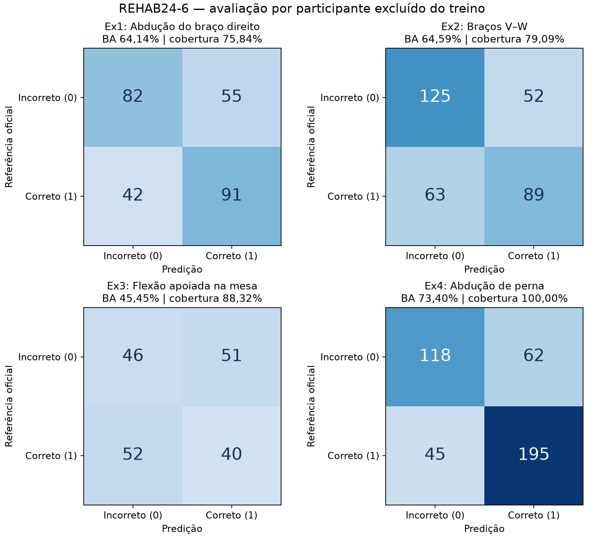

# Resultados do módulo de fisioterapia

Execução em 10/11/2026. A implementação e os testes de engenharia estão concluídos para os quatro exercícios solicitados. A classificação permanece experimental: **Ex3 tem desempenho insuficiente**, e os demais resultados também não comprovam confiabilidade clínica.

## Dados e método

- REHAB24-6 v1, somente Ex1–Ex4: 47 gravações em duas câmeras, **94 vídeos**, **260.750 frames**, dez participantes e **703 repetições únicas**. As duas câmeras fornecem **1.406 observações**, não 1.406 repetições independentes.
- Todos os vídeos foram extraídos com YOLOv8n Pose; nenhum frame foi descartado por amostragem. PyAV verifica sequência, geometria e timestamps. Quatro amostras, uma por exercício, foram inspecionadas com postura sobreposta.
- Intervalos e identificação do exercício vêm das anotações oficiais. A correção é prevista por Random Forest, sem usar o rótulo como entrada. Esta versão não segmenta repetições automaticamente.
- GroupKFold com cinco grupos por participante, mantendo câmeras juntas. Imputação ajustada apenas no treino. Os 20 modelos (quatro exercícios × cinco grupos) excluem do treinamento os participantes usados em suas respectivas predições de avaliação/demonstração.
- Random Forest: 300 árvores, min_samples_leaf=2, class_weight=balanced, random_state=42. Parâmetros fixados antes de observar os resultados; nenhum retreino visando melhorar esta avaliação.
- Postura exige confiança mínima de ponto 0,5 e cobertura mínima de 60% nas medidas essenciais. Associação perdida por mais de 15 frames não é retomada automaticamente; dados insuficientes geram `Não conclusivo`.

## Métricas fora do treino

Balanced accuracy é a média dos recalls das duas classes. BA e F1 abaixo são calculados apenas nas observações classificáveis; a cobertura mostra a parcela em que houve classificação. O baseline escolhe a classe majoritária de cada conjunto de treino e usa exatamente os mesmos grupos/casos de teste.

| Exercício | Classificadas/total | Cobertura | Balanced accuracy | BA do baseline | F1 macro |
|---|---:|---:|---:|---:|---:|
| Ex1 — Abdução do braço direito | 270/356 | 75,84% | 64,14% | 50,00% | 0.640 |
| Ex2 — Braços V–W | 329/416 | 79,09% | 64,59% | 43,53% | 0.646 |
| Ex3 — Flexão apoiada na mesa | 189/214 | 88,32% | 45,45% | 38,94% | 0.454 |
| Ex4 — Abdução de perna | 420/420 | 100,00% | 73,40% | 50,00% | 0.736 |

Todos superaram numericamente o baseline majoritário agrupado. Isso não demonstra significância estatística. No Ex3, **45,45%** é inferior à referência de **50%** de balanced accuracy binária; o baseline agrupado de 38,94% não torna esse resultado satisfatório. A maioria pode variar entre grupos e produzir BA agregada inferior a 50%. Ex3 continua como pendência de qualidade, sem declaração de exercício validado.

Há 1.208 observações classificadas e 198 não conclusivas (85,92% de cobertura global). Os resultados agregados incluem duas vistas da mesma repetição; essas observações são correlacionadas. Não foi estimado intervalo de confiança nem realizado teste estatístico de superioridade.

## Alcance da detecção de incorretos

O recall condicional considera somente casos classificáveis. O recall sobre **todos** os incorretos inclui também os não conclusivos no denominador; ele expõe a perda de alcance causada por falta de pose confiável. Não conclusivo não é contabilizado como acerto ou predição de correto.

| Exercício | Precisão de incorretos | Recall condicional | Recall de todos os incorretos | Não conclusivos: incorreto / correto |
|---|---:|---:|---:|---:|
| Ex1 | 66,13% | 59,85% | 46,59% | 39 / 47 |
| Ex2 | 66,49% | 70,62% | 54,82% | 51 / 36 |
| Ex3 | 46,94% | 47,42% | 41,82% | 13 / 12 |
| Ex4 | 72,39% | 65,56% | 65,56% | 0 / 0 |

## Diagnóstico por câmera

| Exercício | Câmera | Balanced accuracy | Cobertura | Classificadas/total |
|---|---:|---:|---:|---:|
| Ex1 | 17 | 65,14% | 100,00% | 178/178 |
| Ex1 | 18 | 62,43% | 51,69% | 92/178 |
| Ex2 | 17 | 58,96% | 100,00% | 208/208 |
| Ex2 | 18 | 74,17% | 58,17% | 121/208 |
| Ex3 | 17 | 52,14% | 76,64% | 82/107 |
| Ex3 | 18 | 40,35% | 100,00% | 107/107 |
| Ex4 | 17 | 75,42% | 100,00% | 210/210 |
| Ex4 | 18 | 71,39% | 100,00% | 210/210 |

A câmera 18 tem baixa cobertura em Ex1 e Ex2. A inspeção de amostras mostrou limitações de visibilidade e associação; não foi feita uma auditoria manual de todos os casos rejeitados. Em Ex3, a câmera 18 teve cobertura total, porém BA de 40,35%, mostrando que cobertura suficiente não garante classificação correta. Melhorias devem investigar medidas e pose, sem concluir que confiança dos pontos equivale a correção terapêutica.

## Matrizes de confusão

Somente casos classificáveis. Linhas representam o rótulo oficial; colunas, a predição. Classe 0 = incorreto; classe 1 = correto. As contagens completas e os resultados por participante estão em [avaliacao.json](avaliacao.json).

## Evidência de engenharia e demonstração

- **53 testes Python passaram**, com dois avisos de depreciação upstream WFDB/pandas. Incluem medidas, bordas/índices, dataset, agrupamento, predição sem rótulo, cache, falhas/reinício, API/Range/CORS e regressão das rotas de sinais vitais. O teste de inicialização também bloqueia explicitamente as bibliotecas opcionais de visão.
- **Quatro testes de navegador passaram**, sem skips: três cenários controlados e um cenário real que percorreu os quatro exercícios. Houve reprodução de MP4 com busca temporal, navegação por repetição, download e validação do relatório; predições excluíram o participante do treino. Nenhum erro JavaScript não tratado foi observado nesses cenários.
- Layout estreito verificado no cenário controlado. As quatro capturas reais desktop foram inspecionadas: `playwright-output/real-ex1.png` até `real-ex4.png` (artefatos locais ignorados pelo Git).
- Na gravação PM_010/câmera 17, a demonstração mostrou 11/16 repetições não conclusivas; o sistema apresenta essa limitação. Nos vídeos de Ex1 e Ex2 há erros mesmo com boa cobertura. A referência oficial fica separada da predição na interface.
- Revisão independente encontrou quatro problemas importantes durante a implementação; todos foram reproduzidos em testes e corrigidos: grupos com participantes sem pose, reutilização de relatório sem cache de pose íntegro, retomada indevida de identidade e identidade inconsistente da engine. Revisões posteriores do decoder, prefetch e métricas não encontraram novos defeitos concretos.

Comandos reproduzíveis estão no [guia de execução](README.md). A avaliação foi gerada por `python -m fisioterapia train` e conferida com `python -m fisioterapia evaluate`; os testes de interface reais usam `FIAP_REAL_API=1 npm run test:e2e` com API local iniciada.

## Ambiente, duração e rastreabilidade

Python 3.12 em macOS arm64, aceleração MPS com lote 8. Versões e hash dos pesos estão em [reproducao.json](reproducao.json); o lock de dependências está na API. O caminho CPU permanece disponível, mas não foi medida uma extração integral em CPU nesta etapa.

A última retomada da extração levou **2.432,4 s (40 min 32 s)**, reaproveitando os caches já concluídos. Esse número **não representa o custo total de processamento a partir de zero**. O processamento anterior incluiu perfilamento, interrupções controladas e invalidação dos caches após mudanças de rastreamento/decoder; o tempo integral limpo não foi medido. O comando de treino levou **13,2 s**, incluindo leitura dos caches e medidas; o ajuste dos modelos registrado no manifesto levou **3,563 s**.

Experimento: `873b859dc49577cef59b94af1255d9a2622abbff1295a8b0c010368651b44aa7`.

Dados, pesos, modelos e caches completos permanecem locais, ignorados pelo Git. O snapshot versionado [avaliacao.json](avaliacao.json) conserva métricas, grupos, esquema de features e hashes dos 20 classificadores, sem redistribuir os vídeos.

## Limites e próximos pontos de qualidade

- Priorizar Ex3: investigar projeção 2D, oclusão dos braços e medidas temporais. A inspeção de uma amostra sugere ruído na série do cotovelo, sem demonstrar a causa de todos os erros.
- Melhorar cobertura em Ex1/Ex2 da câmera 18 e estudar reidentificação com validação explícita, sem permitir troca silenciosa de pessoa.
- Reservar dados de avaliação independentes antes de afirmar melhorias após novas escolhas de modelo/features; a avaliação atual já foi observada. Agrupar também a incerteza por participante, sem tratar câmeras como amostras independentes.
- Nenhum resultado autoriza diagnóstico, causa/gravidade do erro ou recomendação terapêutica. Não foram implementados novos vídeos, webcam, áudio, Azure ou alertas clínicos nesta etapa.
- A conclusão da engenharia deste módulo não conclui a Fase 4. Ver [pendências da entrega](pendencias-fase4.md).
