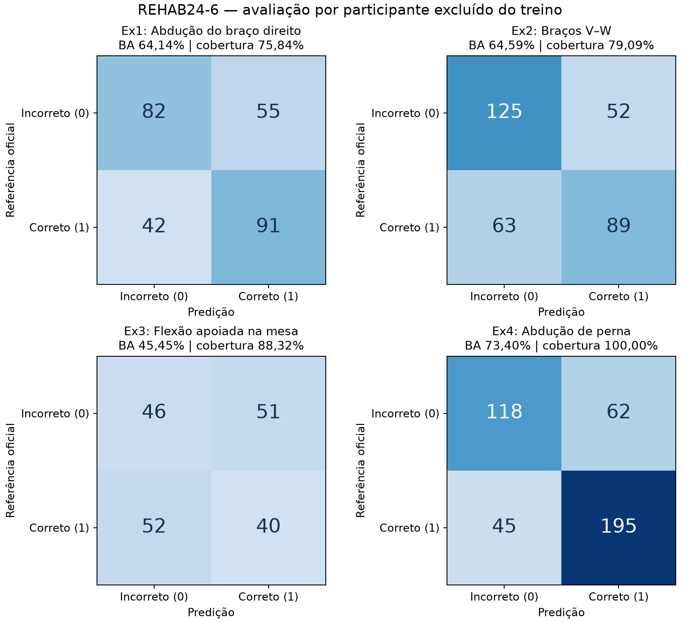

# Relatório técnico — Prontuário Digital

**FIAP Pós-Tech · Tech Challenge Fase 4 · atualizado em 11 de novembro de 2026**

**Estado:** documentação integral do projeto existente; entrega multimodal do enunciado ainda incompleta.

**Repositório:** `gilbertoag2007/fiap-tech-challenge-fase4`, branch de desenvolvimento `feature/modal-video`.

## Resumo executivo

O projeto reúne uma API FastAPI e um frontend estático para duas frentes acadêmicas. A primeira associa um catálogo local de pacientes a registros WFDB do PhysioNet, gera CSV e relatório estatístico de seis sinais vitais e solicita à OpenAI uma interpretação informativa de cada canal. A segunda prepara vídeos de quatro exercícios do REHAB24-6, extrai 17 pontos corporais com YOLOv8n Pose, calcula medidas temporais 2D e classifica repetições com Random Forest treinado por exercício. Ambas aparecem na mesma navegação web, mas os dados e participantes das duas fontes **não são relacionados entre si**.

A avaliação real do vídeo processou 94 vídeos e 260.750 frames, com 703 repetições únicas vistas por duas câmeras. Dos 1.406 exemplos por câmera, 1.208 foram classificáveis e 198 não conclusivos. A balanced accuracy por exercício foi 64,14%, 64,59%, 45,45% e 73,40%; o Ex3 ficou abaixo de 50%, e a cobertura das câmeras varia. Esses valores não constituem validação clínica. O módulo de sinais vitais não dispõe neste repositório de avaliação quantitativa da interpretação OpenAI ou de demonstração integrada real dos serviços externos.

O enunciado da Fase 4 exige também áudio clínico com Azure Speech to Text e Azure Text Analytics, detecção de anomalias em sinais temporais, prescrições e movimentação durante internação, alertas automáticos e demonstração multimodal em vídeo de até 15 minutos. Esses itens não estão implementados. Este relatório apresenta o estado verificável, os resultados existentes e a distância até a entrega completa, sem tratar documentação como evidência de funcionalidades ausentes.

## 1. Escopo, fontes e critérios

A fonte de requisitos é o PDF **IADT - Fase 4 - Tech challenge**, páginas 3–4, fornecido pelo solicitante. As páginas especificam três blocos obrigatórios: análise de vídeo clínico e relatório de desvios; análise de áudio de consultas, alterações vocais e serviços Azure; e anomalias em séries de sinais vitais, prescrições e movimentação na internação, com alertas à equipe. OpenPose e YOLOv8 aparecem como exemplos de modelos possíveis, não como obrigação cumulativa. A página 4 requer repositório Git com código e relatório técnico (fluxo multimodal, modelos por tipo de dado, resultados e exemplos) e vídeo de até 15 minutos em YouTube/Vimeo público ou não listado, mostrando áudio/vídeo, anomalias, Azure e alerta.

A análise deste relatório usa o código-fonte da branch `feature/modal-video`, os manifestos de avaliação versionados e os registros de testes da etapa de implementação do vídeo. O PDF de requisitos é tratado como fonte de critérios, não como instrução para inventar funções ou resultados. As métricas citadas são do experimento armazenado; os testes de serviços externos de sinais vitais não foram executados nesta elaboração do relatório.

| Critério do enunciado | Evidência disponível | Estado |
|---|---|---|
| Processar vídeo clínico | Quatro exercícios de fisioterapia REHAB24-6, duas câmeras; pose YOLOv8 | Implementado no recorte definido |
| Apontar execução fora do padrão e relatar desvios | Classificador binário por repetição; relatório e interface | Parcial: Ex3 insuficiente; sem tipo/gravidade do erro |
| Áudio, alteração vocal, Azure Speech to Text | Nenhum módulo/rota/resultado no código auditado | Pendente |
| Azure Text Analytics, termos críticos e sentimentos | Nenhuma integração no código auditado | Pendente |
| Anomalias em série temporal de sinais vitais | Estatísticas por canal e interpretação agregada por LLM; sem detector temporal | Parcial |
| Anomalias de prescrições | Sem dados, modelo ou rota | Pendente |
| Movimento do paciente durante internação | Os vídeos representam exercícios; sem contexto de internação | Pendente |
| Alerta automático à equipe | Sem regras, destinatário ou fluxo de notificação | Pendente |
| Fluxo multimodal integrado | Dois módulos acessíveis pela mesma UI, sem fusão de sinais/áudio/vídeo | Pendente |
| Git + relatório técnico | Código e este relatório no repositório | Documentado, com lacunas declaradas |
| Vídeo final até 15 min | Não há entrega publicada comprovada no repositório | Pendente |

## 2. Arquitetura implementada

A API declara versão `0.2.0`, agrega os roteadores `/v1/sinais-vitais` e `/v1/fisioterapia` e expõe OpenAPI em `/docs`. O frontend estático usa HTML, CSS e JavaScript, sem bundler de produto. Para a origem local, o CORS permite `GET` e `POST` a `localhost`/`127.0.0.1` com cabeçalhos necessários à busca temporal de vídeo. Persistência é feita em CSV/JSON, arquivos compactados de pose (`.npz`) e modelos `.joblib`; não há banco de dados, autenticação ou separação multiusuário.

```text
Cadastro local + PhysioNet/WFDB
          ↓
CSV de seis canais → estatísticas + OpenAI → relatório JSON → tela de sinais

REHAB24-6/Zenodo → catálogo + vídeos + segmentação oficial
          ↓
PyAV → YOLOv8n Pose → rastreamento → medidas 2D
          ↓
Random Forest por exercício/fold → relatório por repetição → tela de vídeo
```

A tela de sinais consome apenas dados já processados; o POST de importação é acessado por API/Swagger/cliente HTTP. A tela de vídeo inicia uma tarefa local, consulta progresso, reproduz o MP4 via HTTP Range, sobrepõe pontos de pose e sincroniza o gráfico com a repetição. A fila de vídeo é um `ThreadPoolExecutor` com um trabalhador por processo, motivo pelo qual a execução documentada usa um único worker Uvicorn.

Os principais componentes são `controller/`, `services/`, `integrations/` e `fisioterapia/` na API; `pages/` e `assets/js/` no frontend. O fluxo de vídeo não invoca ChatGPT nem Azure. O fluxo de sinais não consome vídeos de fisioterapia. A configuração OpenAI vem de variáveis de ambiente; a preparação de vídeo usa o Zenodo e pesos YOLO oficiais.

## 3. Entrega 1 — sinais vitais e interpretação textual

### 3.1. Dados e processamento

O catálogo versionado `analise-medica-api/data/pacientes.json` contém três associações locais entre identificadores/cadastros e registros WFDB. O importador efetivo usa `id` e `diretorio`; o código não demonstra que nome, CPF, idade ou histórico do cadastro provenham dos metadados clínicos originais dos registros. Para cada importação, `wfdb.rdrecord` requisita `sampfrom=0` e `sampto=600`: são **600 amostras**, cuja duração depende de `record.fs`, não 600 segundos.

O arquivo CSV tem colunas `tempo_segundos` e sinais vindos de `record.p_signal`. Apesar do nome, `tempo_segundos` recebe datas/horários textuais iniciados em instante **sorteado entre janeiro e novembro de 2026**, com incremento `index / record.fs`. Não representam os horários reais da coleta PhysioNet. As lacunas numéricas são interpoladas linearmente, inclusive bordas, e marcadas em colunas `__interpolado`; canais sem medições suficientes continuam vazios. O relatório exclui pontos interpolados das estatísticas numéricas.

Os seis canais tratados são `HR` (frequência cardíaca, bpm), `SpO2` (saturação, %), `NBPs` e `NBPd` (pressões sistólica/diastólica, mmHg), `PULSE` (pulso, bpm) e `RESP` (frequência respiratória, rpm). Para cada canal disponível, o relatório calcula quantidade, mínimo, máximo, média e mediana. A duração estimada usa a diferença entre primeiro e último instante mais o intervalo mediano positivo. As unidades são constantes do programa; não há checagem de plausibilidade fisiológica, tendência ou detector temporal de anomalias.

Há um endpoint de tabelas de referência, mas o arquivo esperado `data/referencias_sinais_vitais.json` **não está no checkout**. A listagem vem vazia, e uma busca por canal retorna 404. Mesmo se presente, a tabela seria apresentada ao usuário: os cálculos estatísticos e o prompt OpenAI não a usam como limiar determinístico.

### 3.2. Interpretação com OpenAI

O serviço envia em uma chamada lógica à Responses API a idade, sexo, histórico textual e resumo dos seis canais (descrição, unidade, estatísticas), solicitando uma saída estruturada com `Normal`, `Alterado` ou `Não Conclusivo` e texto `analise_ia`. A validação Pydantic exige exatamente uma resposta por canal, sem campos extras. Um canal sem estatísticas recebe `Não Conclusivo` imposto pelo backend. Nome, CPF, ID e CSV bruto não são campos enviados no objeto de contexto; o histórico textual é enviado integralmente, sem anonimização automática do conteúdo escrito nele.

O prompt pede interpretação informativa e explicação de incertezas, sem diagnóstico ou prescrição. O status é produzido pela LLM; não há comparação com rótulos clínicos, avaliação por especialista, sensibilidade/especificidade medida, calibração ou limites fisiológicos formais no código. A chave `OPENAI_API_KEY` é necessária para o POST; `OPENAI_MODEL` e `OPENAI_BASE_URL` são configuráveis. Os valores padrão do código não provam que o serviço/modelo esteja disponível na conta de quem executar.

### 3.3. API, arquivos e interface

| Rota | Função e condição |
|---|---|
| `GET /v1/sinais-vitais/paciente` | Lista o cadastro local |
| `POST /v1/sinais-vitais/` | Corpo `{"id":"3000190n"}`; baixa WFDB, gera CSV/relatório e consulta OpenAI |
| `GET /v1/sinais-vitais/relatorio?id=...` | Último relatório disponível para o cadastro |
| `GET /v1/sinais-vitais/datalhamento?id=...` | CSV como anexo; mantém a grafia existente da rota |
| `GET /v1/sinais-vitais/tabela-referencia?sinal=HR` | Referência se o arquivo externo estiver presente |

Cada processamento cria um diretório por nome e timestamp local dentro de `data/`, com `SINAIS_VITAIS_*.csv`, `RELATORIO_*.json` e `ANALISE_IA_SINAIS_VITAIS.json`. Não há transação: uma falha da OpenAI após o download pode deixar apenas CSV. A busca de CSV e relatório é independente, podendo devolver execuções diferentes. POSTs simultâneos podem compartilhar o mesmo diretório de precisão de segundos. A importação não usa fila/caching e pode repetir download e custo de LLM.

A página de sinais permite pesquisar/selecionar um cadastro, consultar CSV e relatório, desenhar seis gráficos e mostrar estado/texto de IA e marcações de interpolação. Carrega snapshots, sem polling, WebSocket ou captura contínua. Não há botão para acionar o POST. A ausência do arquivo de referências impede as faixas na interface atual. A página usa bibliotecas por CDN, com acesso à rede necessário para o visual completo.

**Validação disponível:** dois testes de regressão verificam rotas e inicialização da API sem bibliotecas opcionais de visão. Não testam uma chamada real WFDB/OpenAI, interpolação, estatísticas, persistência ou exatidão clínica. Nenhum CSV/relatório de sinais gerado foi versionado; não há resultado quantitativo dessa entrega a relatar sem nova execução e revisão profissional.

## 4. Entrega 2 — vídeo de fisioterapia

### 4.1. Corpus e preparo

O [REHAB24-6 v1](https://zenodo.org/records/13305826) fornece gravações RGB de duas câmeras, esqueletos de captura de movimento, intervalos de repetição e rótulo binário de correção. O recorte acordado limita-se a Ex1 abdução do braço direito, Ex2 braços entre V e W, Ex3 flexão com mãos apoiadas na mesa e Ex4 abdução de perna. A preparação verificou checksums do Zenodo, extraiu apenas os quatro exercícios e validou câmera, participante, 30 FPS, geometria e limites das anotações.

O recorte contém **47 gravações**, cada uma com câmeras 17 e 18, totalizando **94 vídeos, 260.750 frames, dez voluntários, 703 repetições únicas e 1.406 observações de câmera**. As duas vistas da mesma repetição não são independentes. Os intervalos oficiais têm índices de origem 1 e fim inclusivo segundo a conferência das bordas reais; o adaptador usa `[first_frame-1:last_frame]` internamente. O dicionário textual dos autores não explicita essa origem, portanto o relatório registra a interpretação empírica. Os pontos de esqueletos oficiais não foram usados como predição YOLO, e `mocap_erroneous` não é a classe de exercício incorreto.

### 4.2. Pose, medidas e classificação

O PyAV decodifica todos os frames em ordem de apresentação, verifica timestamps e reduz proporcionalmente a imagem antes da inferência. O `yolov8n-pose.pt` oficial, **pré-treinado e não ajustado neste projeto**, produz 17 pontos COCO com coordenadas normalizadas e confiança. O algoritmo acompanha a pessoa principal por continuidade espacial, rejeita associação ambígua e deixa o restante sem identidade após mais de 15 frames de perda. Os pontos são cacheados em `.npz` com hash, dimensões, configuração e versões da engine.

As medidas usam as dimensões reais do frame para preservar a proporção de aspecto. Ex1 usa ombro/cotovelo/tronco direito; Ex2 usa ombros/cotovelos bilaterais e simetria; Ex3 usa cotovelo e alinhamento corporal; Ex4 usa quadril/joelho, separação de pernas e inclinação. São ângulos **projetados em 2D**, não medidas anatômicas tridimensionais. Por repetição, o sistema calcula estatísticas temporais de cada medida (média, dispersão, limites, quantis, amplitude e variação entre frames adjacentes). Pontos essenciais exigem confiança ≥0,5; medidas essenciais devem cobrir ≥60% dos frames. Ausência de pose suficiente resulta em `Não conclusivo`.

O classificador **treinado pelo projeto** é um Random Forest por exercício. Cada pipeline ajusta um imputador de mediana apenas no treino e usa 300 árvores, `min_samples_leaf=2`, `class_weight=balanced` e seed 42. A avaliação usa `GroupKFold(5)` por participante: ambas as câmeras e todas as repetições de uma pessoa ficam no mesmo lado. Há 20 modelos, um por exercício/fold. Nas análises de vídeos do dataset, o sistema escolhe o modelo do fold em que o voluntário ficou fora do treino. O rótulo `correctness` não entra nas features nem na predição; aparece como referência oficial separada no relatório. Não há modelo final para vídeos novos ou pessoas fora do catálogo.

### 4.3. API, interface e persistência

| Rota | Função |
|---|---|
| `GET /v1/fisioterapia/catalogo` | Exercícios e vídeos catalogados, sem rótulos ou caminhos locais |
| `GET /v1/fisioterapia/videos/{video_id}` | MP4 com suporte a `Range` |
| `POST /v1/fisioterapia/analises` | Cria/reutiliza tarefa para `{"video_id":"ID"}`; HTTP 202 |
| `GET /v1/fisioterapia/analises/{job_id}` | Estado/progresso/erro e URLs quando concluída |
| `GET /v1/fisioterapia/analises/{job_id}/relatorio` | JSON com resumo, classificação, cobertura, medidas e referência |
| `GET /v1/fisioterapia/analises/{job_id}/pose` | Pontos normalizados por frame |

Os estados são `pendente`, `processando`, `concluido` e `falhou`. Uma fila local processa um vídeo por vez; jobs e relatórios são JSON atômicos. Um reinício marca trabalhos incompletos como falhos. O cache de um resultado concluído só é reutilizado se relatório e postura correspondente estiverem presentes e íntegros. A interface oferece seleção de exercício/câmera/gravação, acompanhamento, vídeo com esqueleto, gráfico temporal, tabela por repetição, indicação não conclusiva e download. A referência do dataset aparece separada da previsão. Não há upload, webcam, detecção automática do exercício ou segmentação de novas repetições.

### 4.4. Experimento e resultados observados

A avaliação fora do treino cobre as 1.406 observações das duas câmeras. As métricas de acerto abaixo consideram apenas amostras classificáveis; o baseline é um classificador da classe majoritária ajustado nos mesmos folds e avaliado nos mesmos casos. `Recall de todos os incorretos` põe também os não conclusivos no denominador, para mostrar o alcance real da detecção.

| Exercício | Classificáveis/total | Cobertura | Balanced accuracy | BA baseline | Recall de todos os incorretos |
|---|---:|---:|---:|---:|---:|
| Ex1 — braço direito | 270/356 | 75,84% | 64,14% | 50,00% | 46,59% |
| Ex2 — braços V–W | 329/416 | 79,09% | 64,59% | 43,53% | 54,82% |
| Ex3 — flexão na mesa | 189/214 | 88,32% | **45,45%** | 38,94% | 41,82% |
| Ex4 — perna | 420/420 | 100,00% | 73,40% | 50,00% | 65,56% |

No total, **1.208 observações classificadas e 198 não conclusivas**, cobertura global de **85,92%**. Todos os exercícios superam numericamente o baseline dos grupos, sem teste de significância. O Ex3 tem balanced accuracy **abaixo de 50%**, portanto permanece uma pendência de qualidade. A câmera 18 tem cobertura de 51,69% em Ex1 e 58,17% em Ex2; em Ex3, a câmera 18 cobre 100%, mas sua BA é 40,35%. A cobertura da pose não garante acerto do movimento. Não foram calculados intervalos de confiança por participante nem feita validação clínica. A distribuição por câmera e por pessoa está em `docs/fisioterapia/avaliacao.json`.



A matriz de confusão é de casos classificáveis; na ordem incorreto/correto, Ex1 = `[[82,55],[42,91]]`, Ex2 = `[[125,52],[63,89]]`, Ex3 = `[[46,51],[52,40]]` e Ex4 = `[[118,62],[45,195]]`. Os rótulos provêm da segmentação oficial e não descrevem causa, gravidade ou correção terapêutica. Um exemplo concreto da interface, PM_010/câmera 17, marcou 11 de 16 repetições como não conclusivas; o sistema expõe essa limitação em vez de dar resposta binária sem postura suficiente.

**Validação de engenharia registrada:** 58 testes Python passaram (com dois avisos de depreciação upstream WFDB/pandas); quatro testes de navegador passaram, três controlados e um real envolvendo os quatro exercícios, reprodução, seek, download e conferência de que a pessoa ficou fora do treino. Os testes de 11/11 cobrem download HTTP comprimido e retomada após `.part` inválido. Em uma cópia isolada com novas datas dos 94 vídeos, os 20 modelos publicados foram aceitos sem treino e uma gravação de 1.042 frames foi analisada na CPU, gerando dez classificações. Capturas de uma amostra por exercício foram inspecionadas visualmente com pose sobreposta. Testes sintéticos e de navegador não substituem validação estatística/assistencial do classificador.

### 4.5. Artefatos e reprodução

O Git contém os pesos `yolov8n-pose.pt`, os 20 `.joblib`, manifestos e métricas. **Não** contém vídeos, downloads, catálogo local, configuração de execução nem cache de pose. O manifesto preserva a identidade original do treino, que registra versões, dispositivo/lote e `mtime` das mídias, e acrescenta uma identidade de implantação baseada no conteúdo declarado do catálogo, anotações, pesos, método de pose, features e scikit-learn. Datas locais, dispositivo e lote não invalidam os classificadores publicados. Após instalar as dependências e executar `python -m fisioterapia prepare`, `python -m fisioterapia evaluate` verifica a compatibilidade; a primeira análise de cada vídeo executa YOLO e usa o classificador já treinado. O runtime original foi Python 3.12/macOS arm64, MPS com lote 8; em um clone sem `runtime.json`, a extração usa CPU/lote 1. A portabilidade foi testada em cópia local com novas datas dos 94 vídeos; outros sistemas operacionais não foram verificados nesta entrega.

O comando de treino completo registrou 13,2 s; o ajuste dos modelos, 3,563 s. A última retomada da extração registrou 2.432,4 s **com caches prévios**, portanto esse tempo não mede uma execução limpa do zero. Fonte dos valores, hashes e versões: `docs/fisioterapia/reproducao.json`; resultados completos: `docs/fisioterapia/resultados.md` e `avaliacao.json`.

## 5. Verificação, segurança e limites de uso

O contrato de vídeo foi verificado com testes de dataset, CSV/ZIP, bordas de frame, geometria, cobertura, perda de identidade, agrupamento, cache, rotas HTTP, Range/CORS e navegação real. O contrato de sinais só tem regressões de registro das rotas e dependências opcionais. As chamadas reais pagas/externas e a acurácia clínica da OpenAI **não foram validadas**. A ausência de arquivo de referências, o timestamp sintético e a janela fixa de 600 amostras impedem apresentar a tela de sinais como detector validado de anomalias temporais.

A API não tem autenticação/autorização; o catálogo expõe identificadores e dados cadastrais. O ambiente documentado é local, e arquivos de `.env` não devem ser versionados. O fluxo OpenAI transmite resumo e histórico textual; isso exige revisão de dados e autorização antes de qualquer uso com dados reais. Modelos `.joblib` são objetos serializados e devem ser carregados somente da origem controlada; o serviço confere caminho e hash. Os vídeos são de voluntários do REHAB24-6; não são prontuários nem representam movimentação durante internação. Nenhuma saída do sistema equivale a diagnóstico, prescrição ou alerta assistencial validado.

A licença/condições do REHAB24-6 permitem uso acadêmico ou por organização sem fins lucrativos, não comercial, conforme a página do dataset; os vídeos não são redistribuídos no repositório. O projeto mantém atribuição aos autores e deve respeitar também os termos do PhysioNet e dos serviços externos antes da distribuição ou demonstração com dados adicionais.

## 6. Próximas entregas necessárias para cumprir a Fase 4

1. **Sinais temporais:** remover datas sintéticas ou rotulá-las explicitamente, revisar janela de amostragem e desenvolver um detector de anomalias da sequência com avaliação em dados rotulados. Disponibilizar as referências, se forem usadas, com proveniência e validação. Testar importação WFDB/OpenAI e frontend de sinais em cenários reais controlados.
2. **Áudio/Azure:** definir corpus de consultas e consentimento/privacidade, processar fala e alterações vocais, integrar Azure Speech to Text e Azure Text Analytics, avaliar transcrição, termos críticos e sentimentos com exemplos verificáveis.
3. **Prescrições e internação:** obter fontes autorizadas, definir anomalias e contexto temporal, implementar detecção e medir falsos positivos/negativos. Não usar o corpus de fisioterapia como substituto de movimentação durante internação.
4. **Fusão e alertas:** estabelecer como eventos de sinais, áudio, vídeo e outras fontes se relacionam; definir destinatários, limiares, confirmação e registro de alertas, depois demonstrar o fluxo ponta a ponta.
5. **Vídeo:** melhorar o Ex3 e a cobertura da câmera 18 sem reutilizar a avaliação já observada para uma alegação de ganho; reservar dados independentes e obter revisão clínica antes de qualquer uso assistencial.
6. **Entrega final:** atualizar este relatório com resultados reais dos módulos ainda ausentes e produzir/publicar vídeo de até 15 minutos em YouTube ou Vimeo, mostrando áudio/vídeo, anomalias, Azure e alerta conforme a página 4 do enunciado. Nenhum link de demonstração final foi confirmado no repositório auditado.

## 7. Reprodução resumida

No diretório `analise-medica-api`, usar Python 3.12, ambiente virtual e `python -m pip install -r requirements-video.txt`. Esse arquivo fixa as dependências principais, mas não todas as transitivas do ambiente original. Para sinais, configurar `OPENAI_API_KEY` em `.env` e chamar `POST /v1/sinais-vitais/` com um ID existente no catálogo. Para vídeo, executar `python -m fisioterapia prepare`; `python -m fisioterapia evaluate` é uma conferência opcional que mostra métricas já salvas. Os 20 modelos e pesos já estão no Git. A análise pela interface extrai postura do vídeo escolhido quando necessário, sem treino. Iniciar `python -m uvicorn main:app --host 127.0.0.1 --port 8000 --workers 1`. Servir `analise-medica-frontend` com `python3 -m http.server 5500 --bind 127.0.0.1 --directory analise-medica-frontend` a partir da raiz. Executar `python -m pytest -q` na API e `npm run test:e2e` na raiz depois da instalação do Playwright; `FIAP_REAL_API=1` inclui o cenário real quando API/dados estiverem prontos. Comandos, variáveis e limites detalhados estão no [README raiz](../README.md) e no [guia de vídeo](fisioterapia/README.md).

## 8. Referências e artefatos de evidência

- **Enunciado:** IADT — Fase 4 — Tech challenge, PDF fornecido pelo solicitante, páginas 3–4 (requisitos e entregáveis).
- **PhysioNet:** [MIMIC-III Waveform Database, v1.0](https://physionet.org/content/mimic3wdb/1.0/), fonte WFDB usada pelos diretórios do catálogo.
- **REHAB24-6:** [registro Zenodo 13305826, v1](https://zenodo.org/records/13305826), Černek, Sedmidubsky, Budikova e colaboradores, 2024; descrição, segmentação e condições de uso.
- **Pose:** [documentação de pose da Ultralytics](https://docs.ultralytics.com/tasks/pose/) e pesos `yolov8n-pose.pt` versionados no projeto.
- **Evidências locais versionadas:** `docs/fisioterapia/avaliacao.json`, `reproducao.json`, `resultados.md`, `matrizes-confusao.png`, `analise-medica-api/tests/` e `tests/browser/`.

Este documento descreve o estado do código e das evidências disponíveis em 11/11/2026. Seus itens pendentes são requisitos de implementação e validação, não resultados já obtidos.
